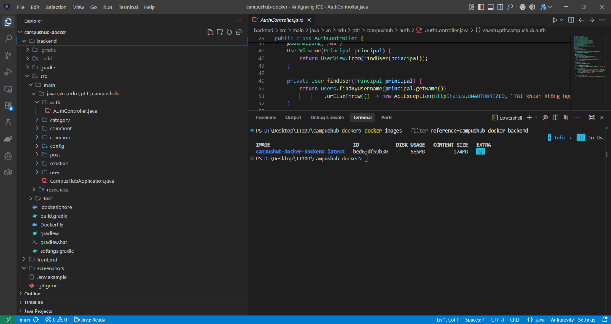
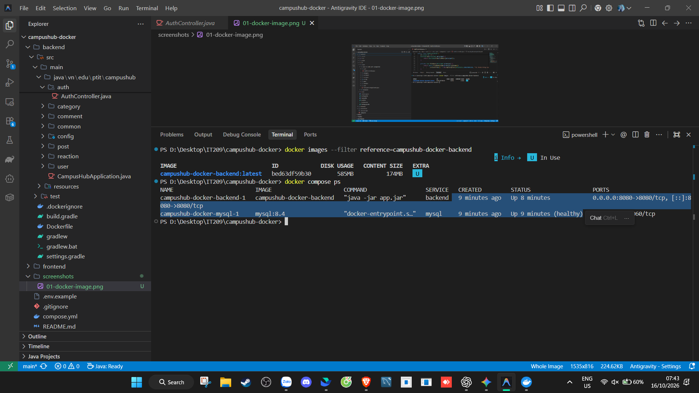
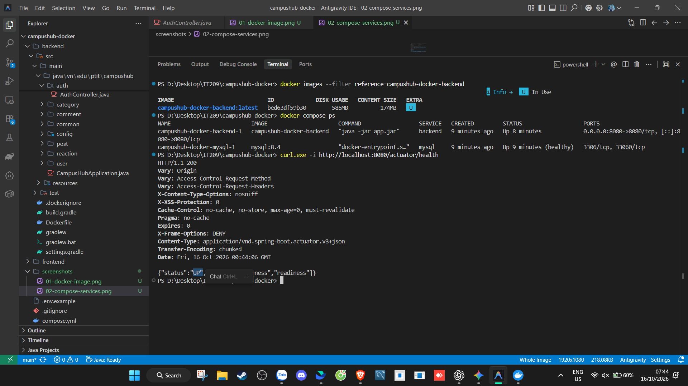

# CAMPUS HUB - DOCKER

Họ tên: Trần Minh Đức<br>
Mã sinh viên: PTIT-HCM-085

Source: https://github.com/dinhthanhnam/campus-hub-base

## Chạy ứng dụng

Yêu cầu Docker Desktop hoặc Docker Engine đang hoạt động.

```powershell
Copy-Item .env.example .env
docker compose config
docker compose up --build -d
docker compose ps
curl.exe -i http://localhost:8080/actuator/health
```

Backend chạy tại http://localhost:8080. Health endpoint: http://localhost:8080/actuator/health.

Kiểm thử backend trước khi build image:

```powershell
Set-Location backend
.\gradlew.bat test
Set-Location ..
```

Compose truyền cấu hình database qua `DB_URL`, `DB_USERNAME` và `DB_PASSWORD`. Backend kết nối tới service `mysql` trên network nội bộ. Giá trị trong `.env.example` chỉ dùng cho môi trường thực hành; không dùng lại mật khẩu này ở môi trường thật.

## Kết quả kiểm tra

- `.\gradlew.bat test`: BUILD SUCCESSFUL, 4 tests, 0 failures.
- Image: `campushub-docker-backend:latest` (`bed63df59b30`).
- `docker compose ps`: backend đang chạy, MySQL healthy.
- `GET /actuator/health`: HTTP 200, trạng thái `UP`.

Ảnh Docker image:



Ảnh trạng thái Compose:



Ảnh health endpoint:


